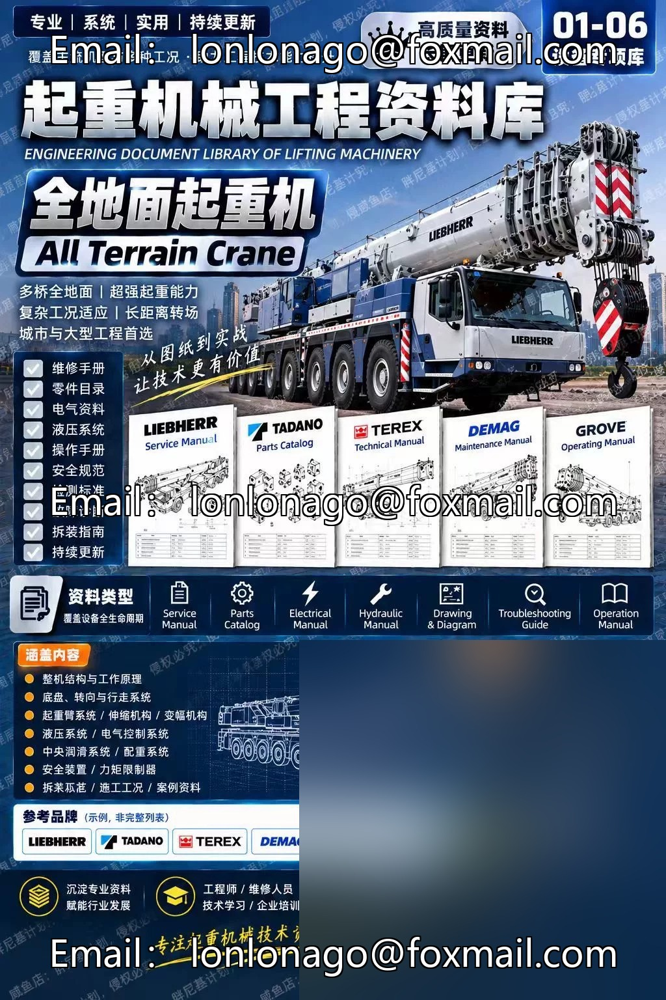

# All Terrain Crane Engineering Data Library |

## Body

Full-terrain crane engineering data library | All Terrain Crane | Large AT hoist · Hydraulic · Chassis · Maintenance · Drawings
[1] [Fire] What equipment is needed please message privately, marked price is not for sale!
Product description:
[Phrygian Plan | Crane Engineering Data Library]
Organization of engineering technical materials for full-terrain cranes, AT Crane, focusing on large-scale, multi-axis, and heavy-duty mobile crane equipment.

Please contact me privately for the required equipment and materials, and the price is not for sale!

The All Terrain Crane engineering database organizes large, multi-axis and heavy-duty mobile crane materials, including drawings, maintenance, operation and electrical/hydraulic resources; it is continuously updated and covers multiple operating conditions.

<!-- AI_ENRICHED -->

## Images

## Payment

Here is a pay link on Stripe ( https://buy.stripe.com/3cs8yP7sY87d0vu9AB ). Please contact me lonlonago@foxmail.com after funding $89, and I will send you a complete data files , thank you!

